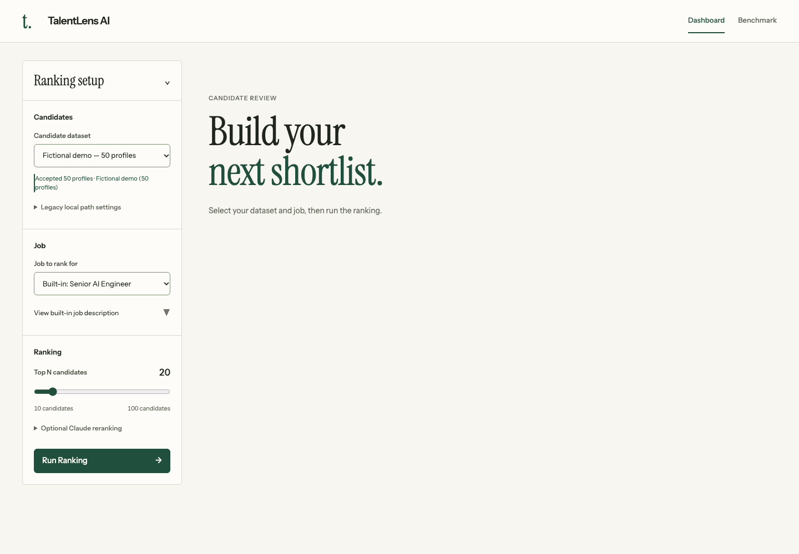
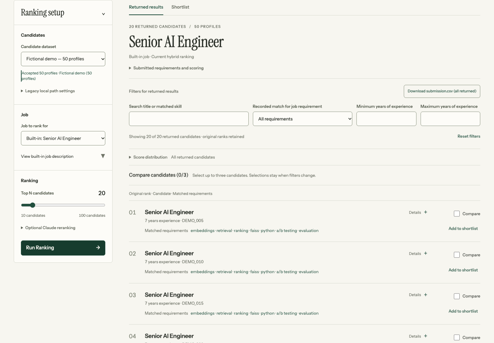
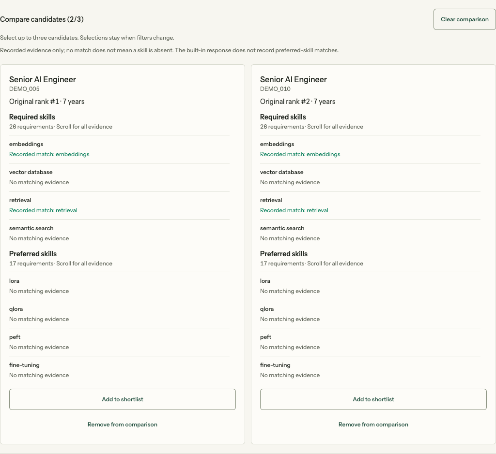
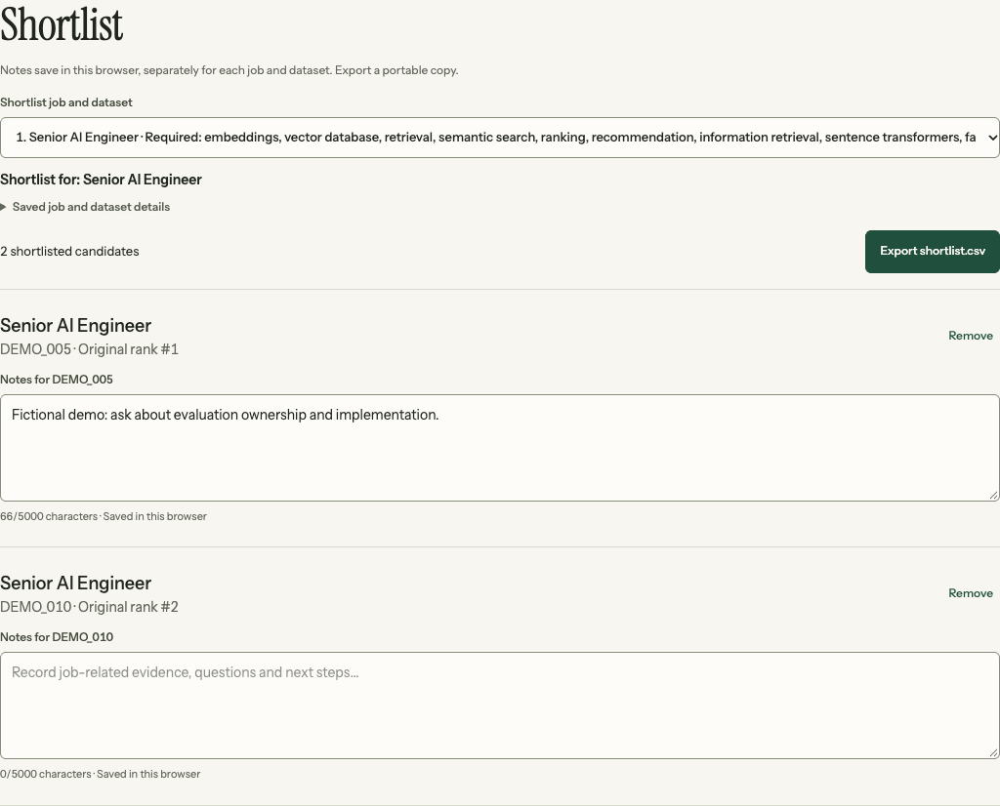
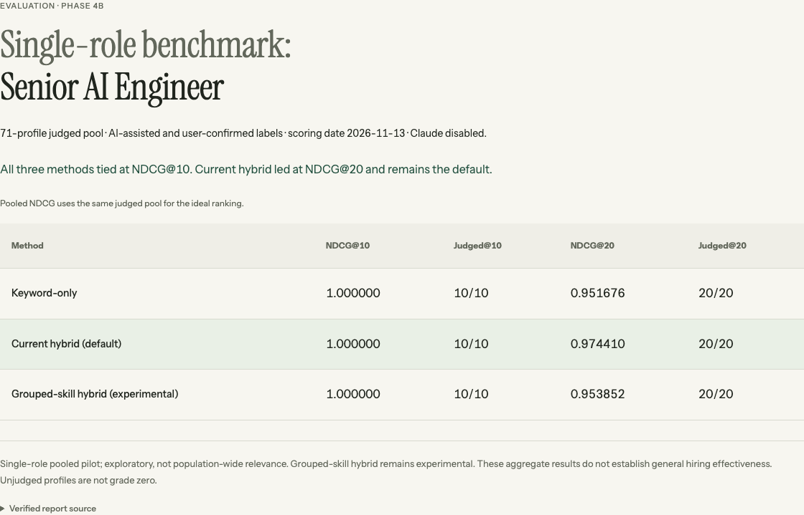

# TalentLens AI

**Local draft — publication blocked pending upstream code/JD permissions and a license decision for new code.** See [PUBLICATION_STATUS.md](PUBLICATION_STATUS.md) and [permission evidence](docs/PUBLICATION_PERMISSIONS.md). No original Git history is included.

A local candidate ranking and review workbench built with React, FastAPI and a pinned Sentence Transformers model. The **current hybrid ranker remains the default**. Grouped-skill scoring is an offline experiment, not a production default.

The Phase 6B dashboard uses warm off-white surfaces, forest-green actions, self-hosted Instrument fonts, compact setup, candidate evidence rows, responsive comparison and reduced-motion support. It supports validated JSON uploads, custom jobs, local filters, browser-local shortlists with notes, and two separate CSV exports. This is a research/demo project, without authentication or a production-deployment claim.

## Preview — fictional profiles only

These are the verified Phase 6B screens, using the deterministic fictional demo. No original candidate screenshots are included.







Narrow layouts: [setup](assets/mobile-setup.png), [results](assets/mobile-results.png), [comparison](assets/mobile-comparison.png), [shortlist](assets/mobile-shortlist.png), [benchmark](assets/mobile-benchmark.png).

## Clean setup

Prerequisites: Python **3.12** with `venv`, Node **24** and npm **11**, and network access for dependency installation and the first model download. Verification used Python 3.12.14 and Node 24.18.0/npm 11.16.0 on Apple silicon macOS. On platforms without `python3.12` on PATH, install Python 3.12 first or use its full interpreter path for the first command.

From the release root:

```bash
python3.12 -m venv .venv
.venv/bin/python -m pip install -r requirements.txt
```

The tested full Python environment is recorded in `requirements-lock.txt`; use that file instead of `requirements.txt` to reproduce the tested transitive versions on a compatible platform.

```bash
cd frontend
npm ci
cd ..
```

Download the pinned model into a new, local-only directory; this does not use any prior model or embedding cache:

```bash
export HF_HOME="$PWD/.model-cache"
.venv/bin/python -c "from pipeline.encoder import load_model; load_model()"
```

Model: `sentence-transformers/all-MiniLM-L6-v2` at revision `1110a243fdf4706b3f48f1d95db1a4f5529b4d41`. Weights are downloaded separately, not bundled. Candidate embedding and scoring run locally. Claude is optional, disabled by default, and requires an exported `ANTHROPIC_API_KEY`. Enabling it sends evidence to the external Anthropic service; release verification makes no live Claude calls.

Start the API in terminal 1, from the release root:

```bash
export HF_HOME="$PWD/.model-cache"
HF_HUB_OFFLINE=1 TRANSFORMERS_OFFLINE=1 .venv/bin/python -m uvicorn server:app --host 127.0.0.1 --port 8000
```

Wait for **Application startup complete** before opening the dashboard. Initial Python/model imports can take longer than Vite startup. In terminal 2, first check:

```bash
curl --fail http://127.0.0.1:8000/api/health
```

Proceed when it returns `{"status":"ok"}`. If the dashboard was opened before the API was ready, reload it after this check.

Then in terminal 2:

```bash
cd frontend
npm run dev -- --host 127.0.0.1 --port 5173 --strictPort
```

Open <http://127.0.0.1:5173/>. Vite proxies `/api` to the local API. Stop both with Ctrl-C before running browser tests; the runner starts its own servers. Keep the API bound locally: compatibility with server-local file paths is retained and is not a remote-upload security boundary.

## Fictional demo walkthrough

1. Wait for **Accepted 50 profiles** with **Fictional demo — 50 profiles** selected. Keep **Built-in: Senior AI Engineer**, Claude off, and top N at 20. Click **Run Ranking**.
2. Filter by candidate title, recorded skill match or experience. Filters only change the returned rows; ranks and the underlying ranking do not change. Expand a row for scores and supporting profile evidence.
3. Compare up to three candidates. Selections survive filter changes and reset with a new ranking. An absent recorded skill match is labeled **No matching evidence**, not a confirmed lack of skill.
4. Add candidates to **Shortlist**, enter notes, refresh and recover them. Shortlists are browser-local and scoped to submitted job requirements and dataset content. Same-title jobs with different requirements and same-name uploads with different content remain separate. Existing path-scoped lists are still readable. Unavailable/invalid storage produces a warning and an in-memory/export fallback.
5. **Download submission.csv** exports every returned row, even while filters are active. **Export shortlist.csv** separately exports candidate ID, title, original rank and notes. Shortlist export quotes commas, quotes and newlines and neutralizes spreadsheet formula prefixes without changing stored notes.
6. Open **Benchmark** for aggregate results and their single-role caveat.

To exercise JSON upload, generate four fictional profiles into a new local-only path (the generator refuses overwrites):

```bash
mkdir -p .release-local
.venv/bin/python scripts/make_post_ranking_demo.py --out .release-local/upload-demo.json
```

Choose **Upload JSON**, select that file and wait for **Accepted 4 profiles**. Choose **Custom job** with title `Platform Engineer`, description `Build reliable Java services and relational data products.`, required skills `Java, PostgreSQL`, preferred skill `Docker`, and experience 3–10. Run Ranking; filter `PostgreSQL`, compare candidates, save notes and export both CSVs. Repeat with the same title but description `Create visual brand identities and accessible design assets.`, required `Figma, Illustrator` and no preferred skills to check job isolation.

Uploads require a UTF-8 JSON array of 1–5,000 unique profiles, at most **10 MiB**. Nested fields and finite numeric experience/signals are validated before ranking; malformed files and duplicates yield actionable errors. Use `pipeline/demo_data.py` and the generated file for schema examples. Uploads stay outside Git under `~/.local/share/talentlens-datasets` (override with `TALENTLENS_DATASET_DIR`). Ranking uses a server-issued identifier. Identical canonical content shares scope; filenames do not determine identity.

### Bundled sample and CLI

`sample_candidates.json` is exactly the **50 fictional profiles** from `pipeline.demo_data.demo_candidates()`. All CLI, API legacy-path, Streamlit and test references to this filename now use that fictional replacement. It is not the original challenge sample or the benchmark dataset.

```bash
mkdir -p .release-local
HF_HOME="$PWD/.model-cache" HF_HUB_OFFLINE=1 TRANSFORMERS_OFFLINE=1 .venv/bin/python rank.py --candidates sample_candidates.json --sample --top-n 20 --coarse-n 500 --no-llm --as-of 2026-11-13 --out .release-local/demo.csv
```

Date omission retains the local-date default; `--as-of`/API `as_of` fixes it for reproducibility. Cache keys cover exact inputs, candidate order and model identity/revision. Candidate caches are reused across jobs; JD caches distinguish job text. `--no-cache` bypasses reads and writes. The release starts with no embedding caches and creates its own on first inference.

`validate_submission.py` retains challenge checks: exactly 100 rows and `CAND_` plus seven-digit IDs. A 20-row fictional demo CSV deliberately does not satisfy those challenge-only constraints. Its header, unique IDs, finite/non-increasing scores, tie ordering and CLI/API parity are checked separately. A separate local full-dataset check used the verified read-only caches and validated its 100-row output; neither that dataset nor its generated output is included.

[Custom scoring and omission rules](docs/CUSTOM_JOBS.md) · [Post-ranking storage/export details](docs/POST_RANKING.md)

## Frozen aggregate benchmark

[data/phase4b_aggregate.json](data/phase4b_aggregate.json) preserves the verified Phase 4B aggregate projection and source-report SHA-256 `94335eb67c107675f627c98d61df637f97138139031c7818f6cb9a226f13b179`.

**71-profile judged pool**, Senior AI Engineer only, scoring date **2026-11-13**, Claude disabled. Labels were **AI-assisted and user-confirmed**.

| Method | Pooled NDCG@10 | Judged@10 | Pooled NDCG@20 | Judged@20 |
|---|---:|---:|---:|---:|
| Keyword-only | 1.000000 | 10/10 | 0.951676 | 20/20 |
| Current hybrid (default) | 1.000000 | 10/10 | **0.974410** | 20/20 |
| Grouped-skill hybrid (experimental) | 1.000000 | 10/10 | 0.953852 | 20/20 |

The methods tied at 10; current hybrid led at 20. This exploratory single-role pooled pilot does not establish general hiring effectiveness. Gain is `2^grade - 1`; the ideal ordering uses the same judged pool. U/unjudged profiles are distinct from zero, and metrics are unavailable for an unjudged top cutoff or zero ideal gain. Any later recall must be **judged-pool recall**. Raw benchmark profiles, labels, manifests, private rankings and caches are not bundled; those aggregate results cannot be independently recomputed from this fictional release. Offline evaluator code and fictional tests are included without modifying the frozen aggregates.

Historical runtime observations, separate from this release setup: fictional50 warm CLI 3.149 s and private 100,000-profile warm CLI 8.903 s on Apple M3/8 GiB/Python 3.12.14, explicit 2026-11-13 date, Claude off and cache hits. The historical Phase 2A full encode was 715.944 s with already-downloaded weights, JD hit, candidate miss, batch 256 and then-local 2026-11-13 date; hardware was not recorded. These differing conditions are not a controlled speedup comparison or a performance guarantee.

## Verification from this release

After the initial model download, from the release root:

```bash
export HF_HOME="$PWD/.model-cache"
HF_HUB_OFFLINE=1 TRANSFORMERS_OFFLINE=1 .venv/bin/python -m unittest discover -s tests -v
.venv/bin/python -m pip check
cd frontend
npm test
npm run lint
npm run build
npm audit
npm audit --omit=dev
npm run test:browser
```

Install a browser once with `npx playwright install chromium`, or set `TALENTLENS_CHROME_PATH` to an installed Chrome executable when running the browser command. The tests use the real local API/model and fictional records at 1440×1000 and 390×844, including normal/reduced motion, real pending-request loading, focus and scroll retention, long requirements, malformed/oversized uploads, invalid records/jobs, contrasting job outcomes, failed-request retry with original job context retained, comparison, refresh recovery, isolation and both downloads. Browser outputs default to the OS temporary directory; `TALENTLENS_BROWSER_OUTPUT` overrides it. The release lockfile uses compatible audit fixes; see [dependency review](docs/DEPENDENCIES.md). The existing >500 kB build chunk warning is recorded, not hidden.

For the opt-in real-API DOM test, keep the API running and set `TALENTLENS_DEMO_DATASET` to the absolute path of the four-profile fictional file before `npm run test:local-api`. The Streamlit `app.py` is a legacy prototype; React/FastAPI is the verified daily workflow.

## Attribution and publication

Based on the original Redrob ranker by **Udhey Goyal**, [upstream repository](https://github.com/Udhey-Goyal/TalentLens-AI). Original author attribution is retained; modifications must not be presented as exclusive authorship. The upstream README describes educational/portfolio sharing but provides no clear derivative redistribution license. The embedded challenge job text also needs permission confirmation.

Instrument Sans and Instrument Serif retain their original OFL notices in `frontend/public/fonts/`. The new fictional sample and Phase 6B screenshots replace every original profile sample/screenshot in this snapshot. Local environments, caches, generated CSVs and uploads are ignored. Fresh local history includes no original commits. The local release remote is the requested `https://github.com/vanshnanda08/Candidate-Ranker.git`; publication remains withheld pending the permission gate. See [PUBLICATION_STATUS.md](PUBLICATION_STATUS.md) before publishing any draft source.
